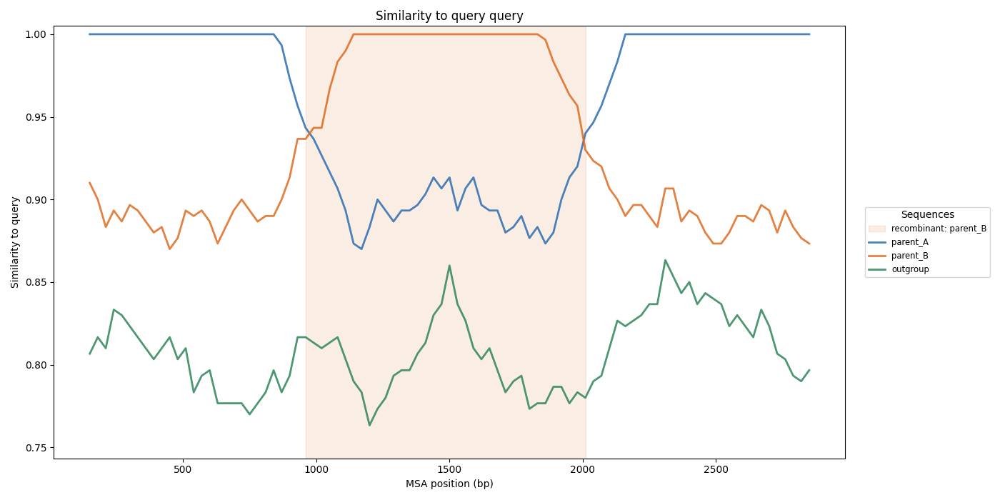
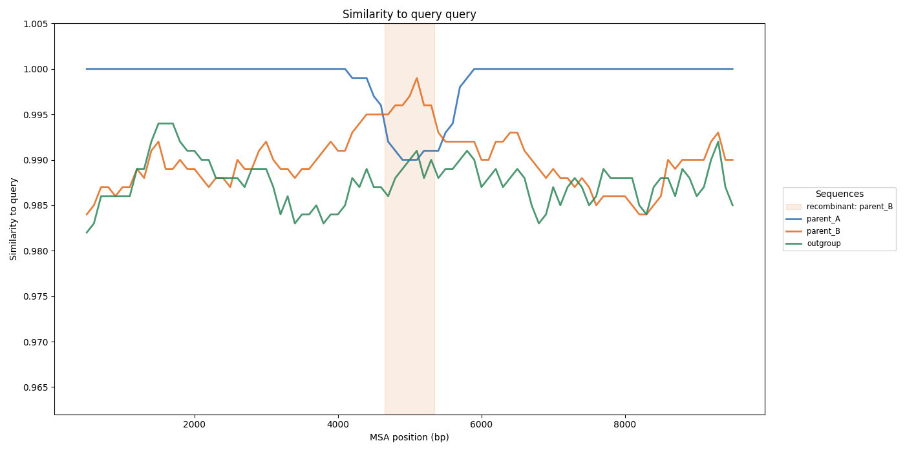

# Detection methods and output

Tessera computes, in sliding windows across the MSA, the similarity of the query to
each reference (1 = identical, 0 = no similarity). The reference winning the most
windows is the **major parent** (the backbone donor). On top of that windowed
similarity it runs one or more parent-attributed callers, plus a parent-free
diagnostic that runs for every method.

## Ensemble (default)

The callers are complementary: 3SEQ recovers short low-divergence tracts the HMM
segmentation dilutes (the `cryptic_insert` example), while the HMM localizes breakpoints
better on divergent parents (the `divergent` example); MaxChi and Bootscan add two more
votes, though not independent ones (see the MaxChi section). By default Tessera runs
**four** of them (`--method hmm,3seq,maxchi,bootscan`) and merges their regions into one
consensus, sharing the single similarity scan so the extra callers are cheap. On the
synthetic harness this leaves the verdict set unchanged but corroborates the donor in 17
of 18 cases (vs 12 with hmm,3seq alone), raising confidence without over-calling.

The merge is transparent -- no combined score is invented. Two regions are the same
event when they overlap in query coordinates and name the same donor -- the same
minor parent genome, two members of one lineage cluster (near-duplicates pooled for
the HMM, below), or, when the references are typed (a lineage map), the same
**lineage**, so two callers that pick different representative genomes of one lineage
still count as the same event and as agreement. The consensus region records exactly
**which** callers found it (the report's *Method(s)* column and a *Method comparison*
table) and whether the parent-free Hudson-Kaplan Rmin signal corroborates it.

Agreement can also be used as a **gate** (`--min-methods`), the control RDP5 exposes as
"list events detected by more than N methods". It is **not on by default**, and the
measurements say why. On a *redundant* panel -- several near-equidistant relatives of the
query -- requiring two callers is a large win: on simulated clonal data, where every
region reported is a false positive, it cuts them from 21 to 2. On the curated,
dereplicated panels the hybrid harness builds it is all cost: it loses three true
detections (`rsv_a`, `mpox`, `masksib_rsv`) and gains nothing, because every negative
control already passes without it.

The reason is that the callers have different applicability domains. At mpox's 0.5 %
divergence only the HMM has power at all, so requiring two of them is structurally
impossible in exactly the regime where detection is hardest. Raise `--min-methods` when
your panel carries near-duplicate references and you want precision; leave it at 1 for a
curated panel. The threshold is clamped to the number of callers that could test -- a
barcode caller without typed references and an HMM left a single state by lineage
clustering do not count -- and any suppressed count is logged rather than silently
dropped. Two of the default callers, 3SEQ and MaxChi, score the same tract (see the
MaxChi section), so a region found by those two alone meets a gate of two without
independent corroboration.

The default ensemble's two further callers are **MaxChi** (a chi-square triplet test
on the same tract as 3SEQ) and **Bootscan** (a distance + bootstrap method that yields a
support for the closest parent). Select callers with a comma list or `all`: `--method
hmm,3seq,maxchi,bootscan` (default), `--method hmm` (one caller, reproducing the
single-method report), `--method hmm,3seq` (the two fastest), or `--method all` (every
caller, including the legacy heuristic). The same `--method` is available on `tessera
detect` and `tessera
fill-references`. The individual callers are described below.

## HMM caller (`--method hmm`)

The default caller segments the query against the reference panel with a hidden
Markov model (jpHMM-style): each window emits a binomial copying likelihood per
reference, and a single jump rate (`--jump-rate`) penalises switching reference, so
near-identical references do not flip and thin windows cannot drive a call. A segment
is reported as recombinant only when its donor beats the major parent on the
**discordant sites** -- positions where the query matches one candidate parent but
not the other -- by a sign test at level `--alpha`. This is far more discriminating
than an all-sites margin (it recovers subtle breakpoints between near-identical
parents) and does not invent regions from noise.

Each region carries a **support** (the share of distinguishing sites favouring the
donor), a sign-test **p-value** with a Benjamini-Hochberg **q-value**
(false-discovery-rate across the segments tested), and a **breakpoint uncertainty
interval**. A high support with a small q-value is a confident call; a region with
strong directional support but a large q-value (few distinguishing sites, e.g. a
recombination between near-identical lineages) is flagged as marginal rather than
dropped. The legacy `--method heuristic` (margin / merge-gap / min-region) is kept
for comparison.

**Which options apply to which caller.** `--min-region` is described in its own paragraph
below. `--margin` (a similarity fraction, 0-1) is read by the heuristic caller only;
`--merge-gap` is read by the heuristic caller and also sets how far apart two coverage
gaps may be and still be merged (default: one window size). The `--help` text of each
scoped option names the callers that read it.

**The reported span is not the segment.** A segment is where the HMM path sat in the
donor state. Once there, the path has no reason to leave while donor and major are
identical, and its ends are only as fine as the window grid. The coordinates reported
for an HMM region therefore run from the first to the last site inside the segment at
which the query matches the donor and not the major; columns matching both parents or
neither cannot hold a region open. A segment that includes the first or last window is
searched to the end of the alignment, so a tract reaching a genome end is reported from
that end. The sign test, its p-value and `support` are computed on the whole segment, so
this step changes where a region is drawn and never whether it is called.
`mean_sim_minor` / `mean_sim_major` are identity over the reported columns.
`n_windows` and `posterior_support` are restated over the reported span as well: the
segment's windows that overlap it, and their mean posterior for the donor state. A
segment's ends are padded by the median spacing between windows, which under
informative-site windowing is not the spacing of the first two windows.
In the final table every row passes through the ensemble merge, which restates both
`mean_sim_*` and `n_windows` over the row's own (for a merged row, the union) span, with
`n_windows` counted in base-pair scan windows; `posterior_support` stays the best member's.

**A posterior at a genome end reads high.** Windows start every `--window-step` and one
further window is placed flush with the alignment end, so that the last
`(width - window) % step` columns fall inside a window at all. That final window can
share up to `window - 1` columns with its predecessor, and the HMM treats each window as
an independent observation, so the evidence in those shared columns is counted twice.
A region whose tract reaches a genome end therefore carries a higher
`posterior_support` than the same tract elsewhere: a 500 bp tail tract measured 0.52 on
a 20 000-column alignment that fits the window grid and 0.9993 on a 20 001-column one
that does not. Whether the region is called is decided by the sign test over the
segment's columns, not by the posterior, and null runs over tail-only segments produced
no extra regions; it is the reported figure that is inflated, so read a
`posterior_support` near 1.0 on a region touching an end as the weaker claim it is. The
same double count reaches the sibling test's beaten-run fraction, which rose from 0.051
to 0.075 on a 1400 bp tail case.

**`--min-region`.** When given, it bounds every reported region: a region shorter than
it, in query bases, is removed after the callers' regions are merged and before the
agreement gate, whichever caller found it. A donor-absent coverage row is a statement
about reference coverage rather than a region a caller called, is added afterwards, and
is not bounded by it. One consequence is worth knowing, because it runs against what the
name suggests: a coverage gap is reported as a donor-absent row only when no called
region overlaps it, so removing a short region can leave its gap with nothing
overlapping, and a bounded run can report a donor-absent row that an unbounded run did
not. On a redundant panel carrying a 1.2 kb block divergent from every reference,
`--min-region 2000` drops two sub-kilobase site-caller rows and reports a 3.0 kb
donor-absent row in their place -- which is the honest statement about that locus once
the short calls are suppressed.

When `--min-region` is not given, the HMM and the heuristic caller apply the window size
as a floor -- the HMM to its segments before they are trimmed, so a trimmed HMM region
can be shorter than a window -- and 3SEQ, MaxChi, Bootscan and GENECONV report regions of
any length: finding tracts shorter than a window is what the site-based callers are for.
Lineage clustering and sibling exclusion also read it, as a run length.

```
Recombination regions (major parent: cowpox_KC813504):
  Minor parent  Major parent     Query start  Query end  Length(bp)  Sim minor  Sim major  Support  q-value   Breakpoint   Method(s)
  ---------------------------------------------------------------------------------------------------------------------------------
  variola       cowpox_KC813504  67252        146829     79577       0.999      0.9796     0.98     7.6e-195  67205-67319  hmm
```

### Near-duplicate references (lineage clustering)

A recruited panel often holds several near-identical genomes of one lineage. Competed
individually they tie in every window and fragment the call, so they are first
grouped into lineage clusters (`--cluster-lineages`, on by default). The clusters are
computed once and shared: the HMM pools them, Bootscan counts their bootstrap support
together, and the merge treats two members of one cluster as one donor. Two
references are pooled when their identity stays at or above 98.5 % in every window,
with no region-sized run below it. The pooled lineage competes as one state under the
label of its best-covering member, and a region names that member. Its evidence in
each window is the mean over its members, not the sum: where the members are
similarly covered, a lineage of five genomes weighs as one genome in the emission, so
adding copies of a reference cannot outweigh a single-genome donor. A member with
little data in a window lowers that window's mean, so a lineage holding a poorly
covered genome weighs as less than one. Clustering is skipped for panels of fewer
than 4 or more than 200 references.

One limitation follows from the absolute threshold when identity is taken over all
columns. On a panel in which *every* pair of references is at least 98.5 % identical
in every window -- mpox, VZV and other sets below roughly 1.5 % divergence -- all
references would pool into a single lineage and leave the HMM nothing to compete.
Such a whole-panel cluster is the one case that is not shared: it reaches the HMM
alone, so Bootscan and the merge go on competing and comparing individual genomes
there -- a cluster holding every reference says nothing about which of them is the
donor. Such panels are scanned under informative-site windowing (next section), and
there the references are compared on the informative columns only, so distinct
lineages stay apart. The limitation remains when base-pair windowing is forced on
such a panel (`--no-informative-sites`): run with `--no-cluster-lineages` to keep the
HMM's vote. The site-based callers (3SEQ, MaxChi) are unaffected either way.
`run_provenance.json` records whether clustering was on.
When clustering does leave the HMM a single state, the run says so: the HMM is reported
as `not run` with this reason in the report header, the method comparison and
`run_provenance.json` (`callers not run`), not as a caller that found nothing. It does
not count toward `--min-methods`, as an unrunnable barcode caller does not.

### Low-divergence panels (intra-species sets, DNA viruses)

When the references are nearly identical -- e.g. mpox clades (~0.5 %), VZV (~0.2 %),
within-species ebola -- a fixed base-pair window holds only a handful of
discriminating columns diluted by hundreds of identical ones, so the per-reference
emission contrast collapses and the segmentation loses power. The signal is still
there (low *percentage* divergence over a large genome is still hundreds of variable
sites), just buried. Tessera therefore switches to **informative-site windowing**:
windows span a fixed number of polymorphic columns rather than a fixed base-pair
width, concentrating the signal so the HMM regains contrast. This is automatic when
the references differ at less than ~8 % of columns, and controllable with
`--informative-sites` / `--no-informative-sites` (and `--informative-window` /
`--informative-step`). Breakpoint intervals are necessarily coarser at low divergence
-- you cannot localise a switch more finely than the spacing of the discriminating
sites.

Before the HMM runs, near-duplicate references are pooled into lineages so that
duplicates do not tie every window (`--cluster-lineages`, on by default for panels of 4
to 200 references). Two references pool when their agreement stays at or above 98.5 % in
every window. Under informative-site windowing that agreement is measured **on the
informative columns**: on a near-identical panel every pair is above 98.5 % over all
columns, and measuring it there would pool the whole panel and leave the HMM nothing to
choose between. On the informative columns only true duplicates agree.

**Informative-site identity is not similarity.** A window of polymorphic columns leaves
out every column where the references agree, so a reference that is 98-99 % identical to
the query genome-wide typically scores 0.4-0.8 there. That contrast is what the HMM
needs, but the number says nothing about how similar the genomes are and must not be
compared with ANI. Tessera therefore keeps the two apart: everything named *similarity*
(`similarity_windows.tsv`, `similarity_stats.tsv`, `window_winners.tsv`, the similarity
plots, and `mean_sim_minor` / `mean_sim_major` in the region table) is identity over all
comparable columns, whichever windowing ran. The windows the HMM segmented are written
to `informative_site_windows.tsv` and drawn as a separate "Identity at informative
sites" track in the report. Up to and including v1.1.0 the informative-site values
were written under the similarity names in this mode.

## 3SEQ caller (`--method 3seq`, scan-aware triplet test)

A second caller, complementary to the HMM, after Boni, Posada & Feldman (2007). For
the query against the major parent and each candidate donor -- **every reference, not
only the window winners**, so a sub-window tract whose donor wins no window is still
tested -- it looks only at the
**discriminating sites** (where the two parents differ and the query matches one of
them) and measures the **maximum drawdown** of the resulting +1/-1 walk -- a
sustained run of donor matches inside the backbone, i.e. a mosaic. Its p-value is the
*exact* probability that a random arrangement of the same matches reaches that
drawdown (a dynamic program over the walk depth, no dependency; a vectorised
permutation falls back for very large inputs), Benjamini-Hochberg-corrected across
the donors tested. Every donor with at least 20 discriminating sites is tested and
counted in that family, however shallow its descent: three consecutive donor matches
among 189 sites are significant (p = 1.7e-4). Counting every donor tested keeps the
correction honest, and makes it stricter than a family of survivors only: a region
v1.2.0 reported may be absent because its q rose. Because it is purely
informative-site based it keeps full power on near-identical panels -- it detects the
mpox clade-I/II recombination where base-pair windowing finds nothing -- and because
the null accounts for scanning every breakpoint it does not over-call.

## MaxChi caller (`--method maxchi`, chi-square triplet test)

A third triplet caller after Maynard Smith (1992) (the RDP family), on the same
discriminating-site +1/-1 walk as 3SEQ but with a different statistic: rather than
the maximum *drawdown* it tests whether the **proportion** of donor matches differs
sharply inside a tract versus outside it -- a 2x2 chi-square -- with a scan-aware
permutation null. MaxChi scores the tract 3SEQ finds -- the same maximum descent of the
same walk -- so the two are **not independent votes**. On 300 simulated clonal walks
their p-values have a Spearman correlation of 0.95 (0.88 over the 143 walks MaxChi
permutes, i.e. excluding donors whose descent is too shallow and which receive p = 1),
and at alpha 0.05 both reject in 3.0 % of walks where independence would give 0.12 %:
MaxChi rejects in 90 % of the walks where 3SEQ does. Each is calibrated on its own
(3.3 % and 3.7 % at a nominal 5 %). A region found by 3SEQ and MaxChi together is
therefore one triplet signal tested twice, not corroborated twice, and `--min-methods 2`
satisfied by that pair alone adds little to either caller. The callers that look at
different evidence are the HMM (per-window copying likelihood over the whole panel,
confirmed by a sign test on the segment), Bootscan (per-window bootstrap of the closest
reference, with a run-length null) and the 3SEQ/MaxChi pair (one tract of the triplet
walk); how far those three are independent of each other has not been measured.

A donor whose descent is shallower than four sites is counted in MaxChi's
Benjamini-Hochberg family with p = 1 rather than permuted, so MaxChi does not call
tracts that short even when its own null would find them significant (on a three-site
tract among 189 discriminating sites its permutation p is 1.5e-4). 3SEQ tests those
tracts exactly and cheaply, and does call them, which is why MaxChi does not spend
20 000 permutations per donor on them.

## Bootscan caller (`--method bootscan`, distance + bootstrap)

The published method of choice for identifying *which parent* a region came from, after
Salminen (1995) (SimPlot++ 2022). Per window it measures the query's identity to each
candidate parent, then resamples the window's alignment columns with replacement; the
**bootstrap support** of a parent is the fraction of resamples in which it is the query's
closest match. A run of windows where a non-major parent's support clears 70 % and beats
the backbone is a candidate region, carrying that support as a confidence the other
callers express only as a p-value. Support is counted per lineage cluster: two
near-duplicates of the donor each win about half the resamples, and neither alone
would reach 70 %.

Support alone is not evidence of recombination, though: it answers *which reference is
closest here*, not *whether the query recombined*. Each candidate run is therefore also
tested against a **permutation null** that holds the donor's number of won windows fixed
and asks whether they are more contiguous than chance -- a recombinant tract is one run,
chance flips are scattered. Windows are permuted in **blocks** one window wide, because
sliding windows overlap and their winners are autocorrelated even with no recombination;
an element-wise shuffle would destroy that structure and make every short run look
significant. The resulting p-values are Benjamini-Hochberg corrected across candidates
and gated on the q-value, exactly as the other callers are. A consequence worth knowing:
with a real null Bootscan clears FDR far less often than its raw support suggested, and
on small tracts it may stay silent.

## GENECONV caller (`--method geneconv`, clean-fragment run test; opt-in)

Sawyer's (1989) GENECONV signal, adapted to the single-backbone triplet setting: over the
major/minor discriminating sites it scores the longest **uninterrupted** run of consecutive
minor-matches (a clean gene-conversion fragment), with a permutation p-value and
Benjamini-Hochberg across donors. It differs from 3SEQ (maximum drawdown, which tolerates a
few interspersed major-matches) and MaxChi (a boundary chi-square). It is **opt-in and not
in the default ensemble**: an adversarial sub-window-tract measurement (see
`validation/README.md`) showed it detects the same tracts the ensemble already finds and,
run alone, did not rescue the short-tract cases. That experiment led to the actual cause of
those misses -- the site callers only tested window *winners* as donors, so a sub-window
tract's zero-win donor was never tested -- which is now fixed for all three site callers
(they draw candidates from `rank_datasets`, winners then the rest). GENECONV stays opt-in:
it was the instrument that found the fix, not the fix itself.

## Barcode caller (`--method barcode`, lineage-marker attribution)

For **typed** panels (a Nextclade dataset or `--lineage-map`), the shared primitive of the
recent lineage-attribution methods (RecombinHunt, rebar, VirusRecom): compete *lineages*
via their characteristic markers rather than individual genomes. It builds per-clade
markers -- columns where one clade is near-fixed for a base rare in every other clade --
and scans the query window by window for the clade whose local markers it carries; a run
where a non-major clade dominates is a region attributed to that lineage. A marker is
denoised across the clade's members and the comparison is multi-way, so the call is robust
to a single near-identical adjacent-clade genome winning by chance -- the failure mode of
the genome-level callers at low divergence. It is opt-in and needs typed references. On an
untyped panel it cannot run, which is not the same as finding nothing: in an ensemble it is
logged and shown as `not run` in the method comparison, and a run that selected only
`barcode` is refused. It composes with `--pool-consensus` but needs only a typed panel.
A barcode region carries a support but no p-value or q-value: the caller has no
significance test, and its regions count toward `--min-methods` like any other caller's.
Whether they should is an open decision
(`docs/superpowers/specs/2026-10-01-min-methods-default-decision.md`).

## Parent-free recombination signal (PHI + Rmin)

Alongside the parent-attributed regions, every run reports a parent-agnostic
diagnostic that asks only whether the alignment carries recombination at all, with no
candidate parents required -- the regime where the HMM and 3SEQ callers have least to
work with (low divergence, or the true donor absent from the panel). It is built from
the alignment's biallelic informative columns and the four-gamete test (two columns
are incompatible when all four gametes are present, which implies a recombination
between them).

The **PHI test** (Pairwise Homoplasy Index; Bruen, Philippe & Bryant 2006) is
significant when columns near each other on the genome are more compatible than a
random reordering -- the signature of shared local genealogy under recombination --
with a one-sided permutation p-value. **Rmin** (Hudson & Kaplan 1985) is the minimum
number of recombination events the incompatibilities force, with the intervals as
breakpoint candidates. Both are dependency-free.

**The two are not interchangeable, and only one of them is a test.** Hudson-Kaplan
bounds recombination *under the infinite-sites model*: it counts four-gamete
violations, and under a finite-sites model recurrent mutation produces those with no
recombination at all. On strictly clonal simulated data Rmin rises from 13 to 991
across a 2-24 % divergence ladder while the true answer is zero throughout -- the
implementation is correct (it returns 0 whenever the infinite-sites assumption
actually holds), but the statistic does not discriminate. PHI does: it permutes
against exactly that background, and on the same clonal data its false-positive rate
was 2.5-7.5 % against a nominal 5 %.

So a region is flagged `parent_free_support` only when **both** agree -- PHI
significant (there is recombination in this alignment) *and* an Rmin interval
overlapping the region (it is here). Neither half suffices: PHI is genome-wide and
localizes nothing, while a non-zero Rmin is the normal state of any finite-sites
alignment. An empty parent-free flag therefore means the parent-free track has
nothing to add, not that the region is wrong.

On the synthetic-hybrid harness, Rmin is non-zero for every recombinant across the
full divergence range (dengue serotypes at 33 % down to the mpox clade-I/II
recombination at 0.5 %) -- but, per the above, so it is for non-recombinants, so read
that as a description of the data rather than as evidence. The PHI test reaches the
permutation floor in most cases. PHI's genome-wide p-value is conservative in
Tessera's typical setup, though:
when the panel is clean parental clades around a single hybrid query, the many
clade-defining sites are mutually compatible and dilute the few incompatibilities the
one query introduces, so PHI can stay non-significant even where detection succeeds
(e.g. yellow fever). In that regime Rmin and the per-site PHI **profile** -- which
localizes the signal rather than averaging it away -- are the more informative
parent-free outputs. The diagnostic runs for every `--method`; disable with
`--no-phi`.

The PHI window (`--phi-window`, default 100) is counted in informative-site ranks and
is an **upper bound**: the window used is capped at a tenth of the informative sites.
PHI asks whether *nearby* sites are more compatible than a random reordering, and
"nearby" stops meaning anything once the window spans most of the sites -- at 159
informative sites a 100-rank window gave p = 1 on an alignment whose tract every caller
found, where a 15-rank window gives p = 0.001. Alignments with a thousand informative
sites or more are unaffected. The report and `recombination_profile.tsv` state the
window that was used. The per-site profile is smoothed over the same window, so on an alignment
with few informative sites it is close to the raw per-site values.

The PHI p-value is judged at the run's `--alpha`, in the report and for the per-region
flag alike. If every pair of sites fell inside one window, reordering the sites could not
change the statistic and the permutation p-value would be 1 whatever the data; the cap on
the window described above keeps the test clear of that case for any alignment that
reaches the minimum of ten informative sites. Should the test still be undefined, Tessera
reports `not testable` (`NA` in the `recombination_profile.tsv` header) rather than a
non-significant result. When the test gives no result -- not testable, fewer than ten
informative sites, or turned off with `--no-phi` -- the report says so with the reason,
and `parent_free_support` reads `not run` in both TSVs and in the method comparison.
`run_provenance.json` records the last two under `recombination signal (PHI)` as
`not run (<reason>)` and the first as `not testable (<n> informative sites, window <w>)`. That is not a negative: no region was corroborated or contradicted.
With few informative sites the window is only a few ranks wide and the test has limited power.

This all remains an **indicative screen**: the built-in HMM and 3SEQ tests are fast
triplet/segmentation screens, not a full tree-based analysis (such as GARD). Treat
regions as candidates to confirm.

## The divergence window: too little signal, and too much

Detection needs the references to be diverse enough to carry discriminating sites, and
that lower bound is well known -- Posada & Crandall (2001) put it around 5 % divergence,
and Tessera switches to informative-site windowing below ~8 % precisely to hold on longer.

There is an **upper** bound too, and it is easier to miss because it does not look like
failure. Measured on the Jaya et al. (2023) simulated grid
(`validation/run_caller_benchmark.py`, per-query detection rates):

| simulated mutation rate | clonal (no recombination) | recombining | discrimination |
|---|---|---|---|
| 0 to 1e-05 | 0 % | 0 % | 0 pt |
| 0.0001 | 3 % | 3 % | -1 pt |
| 0.001 | 0 % | 1 % | +1 pt |
| **0.01** | 7 % | 17 % | **+11 pt** |
| 0.1 | 33 % | 37 % | +4 pt |

At the top of that range the callers fire on **a third of scans over data containing no
recombination at all**, and barely separate those from genuinely recombinant ones. The
sequences are saturated: homoplasy is everywhere, the closest reference flips between
windows as noise, and a high detection rate reflects that noise rather than power.

The practical readings:

- A high call rate on a very divergent panel is **not** evidence of lots of recombination.
  Check the divergence first (`similarity_stats.tsv` medians) before trusting a busy region
  table.
- The parent-free PHI test is the better instrument at high divergence: it stayed at
  specificity 1.00 on the same grid where the region callers reached a 33 % per-query false
  rate. When PHI is non-significant and the panel is saturated, treat regions sceptically.
- Panels assembled by `build-panel` / `curate-panel` are dereplicated and typically sit
  inside the usable window; a hand-assembled panel spanning very distant taxa may not.

## Output files

| File | Contents |
|---|---|
| `report.html` | Self-contained report: run provenance, the region table, the per-dataset stats, and an embedded interactive plot |
| `recombination_regions.tsv` | Called regions: minor/major parent, start/end in **both MSA columns and query bases**, `length_bp` / `length_msa`, `posterior` (the best contributing caller's value over its own span, not the whole row's span), `support`, `pvalue` / `qvalue` with the `test` and `statistic` that produced them, `n_windows` (base-pair scan windows overlapping the region, the same unit for every caller), mean similarities (identity over the region's own span, for a merged row the whole merged span), the calling `methods`, and `parent_free_support` (`not run` when the PHI test gave no result) |
| `recombination_methods.tsv` | Ensemble breakdown (only when several methods run): one row per row of `recombination_regions.tsv`, in the same order (a donor-absent region reads `no` for every caller that ran), with `yes` / `no` per method (`not run` for a selected caller that could not run) and the parent-free flag; the parent-free flag is `not run` likewise |
| `recombination_profile.tsv` | Parent-free signal: header with the PHI p-value (`NA` when not testable) and Rmin, then per-informative-site local incompatibility (the PHI profile) |
| `similarity_windows.tsv` | Full per-window matrix: `msa_position`, `query_position`, `winner`, and one similarity column per dataset. Always base-pair windows (identity over all comparable columns) |
| `informative_site_windows.tsv` | Only under informative-site windowing: the windows the HMM segmented -- `msa_position`, `query_position`, the window's `msa_start` / `msa_end` (end-exclusive), `winner`, and per dataset the query's identity **at polymorphic columns only**. Not comparable with similarity or ANI |
| `similarity_stats.tsv` | Per-dataset similarity statistics (median, windows above identity thresholds) |
| `window_winners.tsv` | Per-dataset count of windows won (ties included) |
| `coverage_gaps.tsv` | Stretches where even the closest reference is below the best-similarity threshold, with a `kind`: gaps closer than `--merge-gap` (default one window size) are merged; `divergent` (the query is far from every reference -- a possible missing reference), `low_information` (too few comparable bases to judge -- shown in the report as its own note, not as a possible missing reference), or `breakpoint` (windows straddling a called breakpoint: each under-threshold window is matched, to the threshold, by a single switch between the region's two parents; not a missing reference, and it does not caveat the region) |
| `similarity_top{N}.{fmt}` | Static plot of the nearest `--top-n` datasets, called regions shaded |
| `informative_sites_top{N}.{fmt}` | Only under informative-site windowing: the same plot for identity at informative sites |
| `similarity_pair.{fmt}` | Static plot of the major parent against the donor of the longest called region, regions shaded (the two leading window winners when no donor was called) |
| `run_provenance.json` | Machine-readable record of the run: Tessera version, parameters, caller description, and -- when the alignment came from `tessera msa` -- the aligner, its version and its arguments |

### Reading `pvalue`, `support` and the lengths

The four callers do not share a statistic, and all of them write into the same two
columns. `pvalue` is a one-sided sign test on discordant sites for the HMM, an exact or
permuted max-descent test for 3SEQ, a scan-aware chi-square permutation for MaxChi, and
a block-permutation run length for Bootscan; `support` is correspondingly a
discordant-site fraction, a tract-match fraction, or mean bootstrap support. **The
values are not comparable across tests**, so every row names its own in the `test` and
`statistic` columns. This matters most for an ensemble row: the merge keeps the single
most significant member's p-value, so a region listing four agreeing callers carries a
p-value from one of them, and `test` is what says which.

`qvalue` is a Benjamini-Hochberg correction applied **within one caller's own candidate
segments** -- not across callers, and not across the genome. A run using the default
ensemble therefore has no single genome-wide false-discovery rate; treat the q-values as
per-caller. `run_provenance.json` records this under `multiple testing`.

`length_bp` is query bases (`query_end - query_start`) and `length_msa` is alignment
columns (`msa_end - msa_start`), which include gaps and so is the larger of the two.
Coordinates are 0-based and end-exclusive in both systems. `NA` marks a value that does
not apply -- the barcode and heuristic callers report no p-value at all.

### Provenance

The TSVs travel: once copied out of the output directory, nothing in them says which
version or parameters produced them. `run_provenance.json` is the record to keep beside
them. Its `run` block holds what the report's methods section shows; it states the coordinate convention under `coordinates`, and under informative-site windowing `window / step` names the base-pair scan it describes (the HMM's windows are given under `windowing`); its `msa` block is
the sidecar written next to the alignment by `tessera msa`
(`<msa stem>.provenance.json`), naming the aligner, the resolved binary versions, any
`--aligner-arg` values and the backbone. For an alignment you built yourself there is no
sidecar and `msa` is `null` -- the run reports what it knows rather than guessing.

The permutation callers (3SEQ, MaxChi, Bootscan, and the PHI diagnostic) seed their RNG
per call from fixed values, so a rerun on the same input reproduces the same p-values;
`run_provenance.json` records this as `permutation seeding`.

Similarity is computed only over columns where both sequences carry a canonical base
(A/C/G/T); gaps, `N` and IUPAC ambiguity codes are ignored, so an `N` never counts as
a match. A window with no comparable position -- for example an inter-contig gap in a
fragmented query -- is uninformative and reported as `NA` in `similarity_windows.tsv`
(and excluded from the winners, statistics and region calling). Query coordinates are
reported alongside MSA coordinates, so regions need not be mapped back to the query by
hand.



*`example_data/divergent.msa.fasta` (parents ~11 % apart). The query tracks `parent_A`
except over the shaded called region, where it switches to `parent_B`. With divergent
parents the HMM caller localizes the event confidently (q ~1e-29); 3SEQ agrees.*



*`example_data/cryptic_insert.msa.fasta` (parents ~1 % apart, an 800 bp insert with
~10 discriminating sites). The dip is shallow and narrow, so the HMM segmentation
finds nothing across a base-pair window; `--method 3seq` pools the discriminating
sites and recovers the shaded region (q ~1e-12).*

## References

The callers and statistics reimplemented here (dependency-free numpy) follow these
sources:

- **HMM segmentation + per-clade consensus (jpHMM-style).** Schultz A-K, Zhang M,
  Leitner T, et al. (2006). A jumping profile hidden Markov model and applications to
  recombination sites in HIV and HCV genomes. *BMC Bioinformatics* 7:265.
- **MaxChi.** Maynard Smith J (1992). Analyzing the mosaic structure of genes. *Journal
  of Molecular Evolution* 34(2):126-129.
- **Bootscan / SimPlot.** Salminen MO, Carr JK, Burke DS, McCutchan FE (1995).
  Identification of breakpoints in intergenotypic recombinants of HIV type 1 by
  bootscanning. *AIDS Research and Human Retroviruses* 11(11):1423-1425. SimPlot++:
  Samson S, Lord E, Makarenkov V (2022). *Bioinformatics* 38(11):3118-3120.
- **Lineage-marker attribution (barcode).** Alfonsi T, Bernasconi A, Chiara M, Ceri S
  (2024). Data-driven recombination detection in viral genomes. *Nature Communications*
  15:3187 (RecombinHunt); the same per-lineage characteristic-mutation idea as rebar/sc2rf.
- **3SEQ triplet test.** Boni MF, Posada D, Feldman MW (2007). An exact nonparametric
  method for inferring mosaic structure in sequence triplets. *Genetics* 176(2):1035-1047.
- **GENECONV (clean-fragment run test).** Sawyer S (1989). Statistical tests for detecting
  gene conversion. *Molecular Biology and Evolution* 6(5):526-538.
- **PHI test (Pairwise Homoplasy Index).** Bruen TC, Philippe H, Bryant D (2006). A
  simple and robust statistical test for detecting the presence of recombination.
  *Genetics* 172(4):2665-2681.
- **Four-gamete test and Rmin.** Hudson RR, Kaplan NL (1985). Statistical properties of
  the number of recombination events in the history of a sample of DNA sequences.
  *Genetics* 111(1):147-164.
- **Benjamini-Hochberg false-discovery-rate control.** Benjamini Y, Hochberg Y (1995).
  Controlling the false discovery rate: a practical and powerful approach to multiple
  testing. *Journal of the Royal Statistical Society B* 57(1):289-300.
